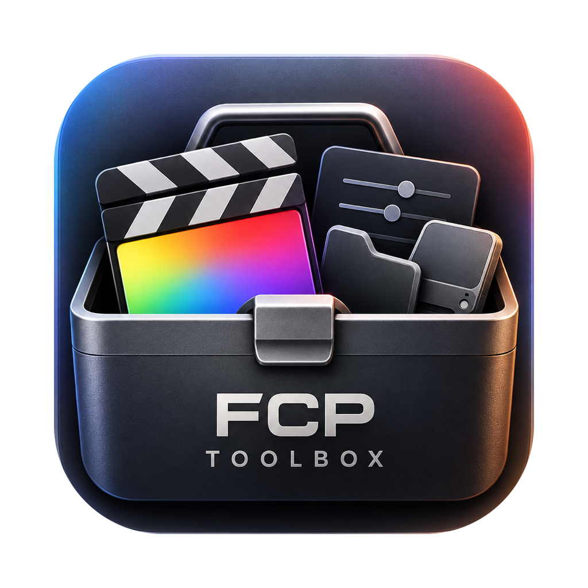
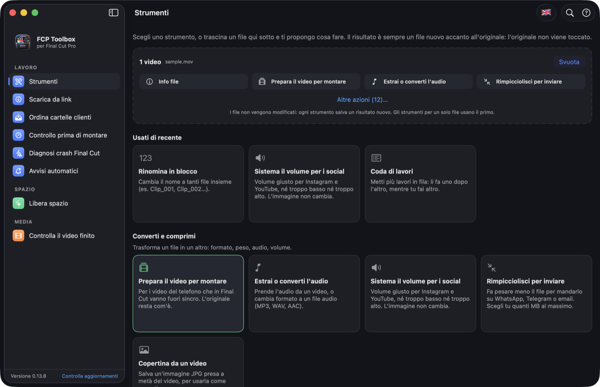
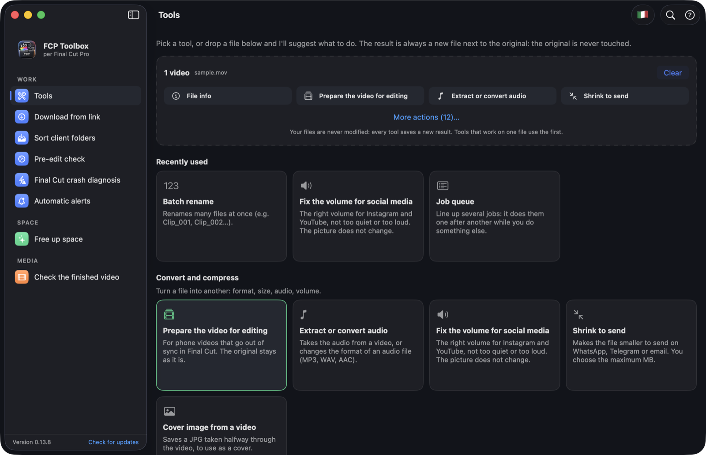
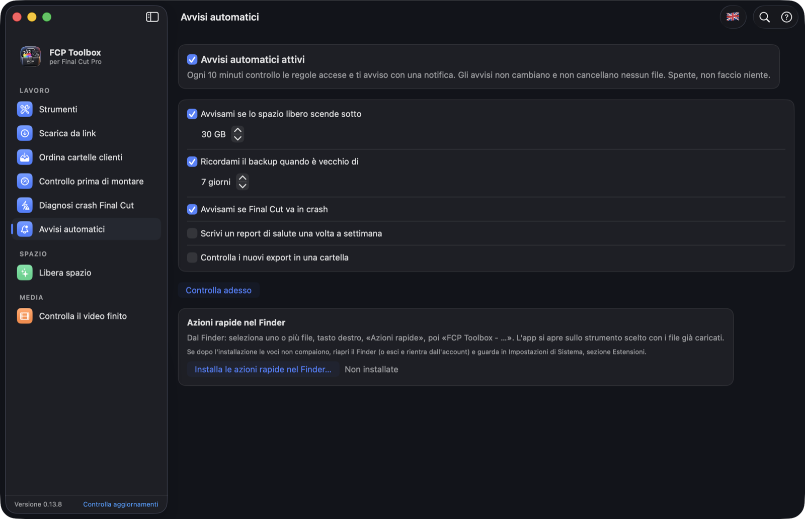

<p align="center"></p>

# FCP Toolbox

🇬🇧 English · [🇮🇹 Italiano](README.md)

**The free toolbox for editing with Final Cut Pro on a Mac.** Free up disk space without touching your originals, find orphaned and missing media, sort client folders, check your Mac before editing and get Final Cut crashes explained. Plus: verified backups, library health, video tools (convert, compress, trim, subtitles, delivery checks for YouTube and Reels), local AI search through your footage and automatic alerts.

It runs entirely on your Mac: no account, no data sent (the internet is used only when you ask: "Download from link" and "Check for updates"). Free, open source (MIT), in English and Italian.

<p align="center">
  
  
</p>
<p align="center">
  
</p>

## Why it exists

With media on an external disk, Final Cut puts files in `Final Cut Original Media/<import day>/` and leaves only links inside the libraries (`.fcpbundle`). The real weight sits outside the library, and Final Cut doesn't tell you which part is still in use.

## Tools

- **Client pool**: drop the downloaded folder (Drive, Downloads…). It moves or copies it to `Client / Video` (clips in `Originali`, everything else in `Altro`), sorts the clips by name, checks them (VFR, HEVC, 4K, duplicates: the notes say what may slow Final Cut down) and creates an `.fcpxml` file that Final Cut opens as a ready-made event. The client is a guess from the folder name: you can correct it.
- **Preflight**: before a long session it checks space, memory used by other apps, Low Power Mode and temperature, and lets you quit (normal quit, with a save prompt) heavy apps such as the browser. It never touches system apps or Final Cut.
- **Final Cut crashes**: reads the reports in `~/Library/Logs/DiagnosticReports`, groups crashes with the same cause, explains it and copies a ready-to-send text for Apple Support.
- **Disks**: free space, SMART status, a low-space alert, the largest files, and **Format a new disk…** (APFS or Mac OS Extended, GPT) with double confirmation; physical external disks only.
- **Verified backup**: copies a library with SHA-256 checking. It deletes nothing from the backup and never overwrites a backup file that is newer than the original; it only replaces old copies of changed files. Backup history.
- **Menu bar shelf** (icon at the top right): keep files within reach, drag them onto the icon or into the popover and out again. It stores only paths, copies nothing. When the window is closed the app stays in the background, with a light check every 5–10 minutes (Pool clip expiry, alerts if you turned them on, performance samples only while Final Cut is open).
- **Libraries and projects**: the tree of libraries → events → projects and clips, with the real size (including media linked outside the library), search, sorting and CSV export. Select a clip and press the **space bar** for a Quick Look preview, as in Finder. Right-click to move a library, event, project, clip or its original video file to the Trash.
- **Space map**: one row per import day, with size, how much is used by a library and how much isn't. Sortable columns, "Show in Finder".
- **Missing media**: the broken library links (the red clips), showing where a file with the same name still exists.
- **Orphan media**: files that no library found uses. You move them to the **Trash**, never delete them, and you can recover them.
- **Cache and renders**: empties only the renders and optimised media inside the libraries (analysis files only if you choose), never the originals. Here files are deleted straight away, not sent to the Trash: Final Cut recreates them when needed.
- **Library health**: a 0–100 score with the reasons (linked media, backup, space, access, regenerable files), growth over time with a free-space forecast, and a history of the Mac's performance while Final Cut is open.
- **Automations**: alerts for low space, old backups, new crashes, a weekly report and a check of new exports. Everything is off until you turn it on.
- **Media inspector**: real details of each file, delivery check (YouTube, Reels…), subtitles (SRT/VTT checks and fixes) and proxies.
- **Media management**: duplicates (Trash only), rename and organise with undo, folder comparison, SHA-256 fingerprint to verify a copy.

## How it decides what is an "orphan"

It reads the symbolic links in the `Original Media` folder of every event of every library found, and compares them with the files in `Final Cut Original Media`. Whatever no link reaches is an orphan candidate.

**Important:** if you use a library the app hasn't seen (for example on another disk), its files will look orphaned. Add all your disks before moving anything. That's why the app uses the Trash.

## Safety

You decide what to do with disks, folders, libraries, events and projects. The app warns you, it doesn't block you. The fixed rules are few:

- Everything you remove goes to the **Trash**, so it is recoverable until you empty it. The one exception is "Cache and renders", which empties files Final Cut recreates by itself. It asks for confirmation first and tells you what you lose.
- It acts only inside the disks and folders you added, never on the added folder itself.
- Before touching anything it re-checks the path on disk and doesn't trust the displayed list.
- It refuses to delete or move anything if Final Cut Pro is open. Backup only warns you instead: the copy may not be consistent.
- "Cache and renders" doesn't follow symbolic links and doesn't empty originals; use "Libraries and projects" for those.
- "Orphan media" can be moved only if at least one library has been analysed.

## Specifications

| | |
|---|---|
| Version | 0.13.9 |
| Installed app | 19 MB |
| DMG download | about 7 MB |
| Supported Macs | Intel and Apple Silicon, macOS 14 Sonoma or newer |
| Third-party libraries | none (Swift and SwiftUI only) |
| Optional programs | `ffmpeg` for the video tools, `yt-dlp` for "Download from link" (free, the app explains how to install them) |
| Optional add-on | "Search your footage" and "Describe clip" download about 800 MB, only if you turn them on |
| Languages | Italian and English (switch with the flag button in the toolbar) |
| Code | about 12,400 lines in 75 Swift files, 173 automated tests |
| Signing | ad-hoc, no Apple notarisation |
| Licence | MIT |

## Installation

**From Terminal (Homebrew):**

```bash
brew install --cask julesna888/tap/fcp-toolbox
```

**Or with the DMG:**

1. Download the latest `FCP-Toolbox-x.y.z.dmg` from the [Releases](../../releases) page.
2. Open it and drag **FCP Toolbox** into **Applications**.
3. On first launch macOS blocks it, because the app isn't notarised (that needs a paid Apple Developer account). To open it:
   - Try to open it, then **System Settings → Privacy & Security**, and at the bottom press **Open Anyway**.
   - Or from Terminal:

```bash
xattr -dr com.apple.quarantine "/Applications/FCP Toolbox.app"
```

(With Homebrew the installation already does this step.)

## Updating

- **Homebrew:** `brew upgrade --cask fcp-toolbox`
- **DMG:** in the app, at the bottom of the left sidebar, press **Check for updates** (next to the version number). If there is a new version the download page opens: you download the DMG and drag the app into Applications over the old one. It doesn't update itself, and the check runs only when you ask. (Available from version 0.13.7; if you have an older version, download the new DMG from the Releases page.)

## Usage

Drag onto the window the disk where you keep your Final Cut media (⌘O to choose it). The analysis starts by itself.

## Building from source

You need Xcode (or Swift 5.9+).

```bash
git clone https://github.com/YOUR-USERNAME/fcp-toolbox.git
cd fcp-toolbox
swift test
scripts/build_app.sh
```

## Honest limits

- The Pool `.fcpxml` hasn't been tried in a real Final Cut: check that it opens with a small folder. I don't promise it imports faster.
- Proxies are checked (opening, duration, height, codec), but whether Final Cut links them can only be seen in Final Cut. The health score uses weights we chose; performance measurements are from the Mac in use, not a Final Cut benchmark; delivery profiles are indicative.
- The crash explanation recognises only the "Invalid view geometry" cause; the others are grouped without explanation. The formatter has been tested only on a test disk image.
- The app is ad-hoc signed, not notarised: on first launch right-click → Open.
- It recognises folders by name (`Final Cut Original Media`, `Original Media`, `Render Files`…), as Final Cut creates them in English. A different or localised structure isn't seen.
- It doesn't know which clips are inside projects: "used by a library" only means a link exists, not that the clip is edited in.
- Matching missing files by name is a hint, not a guarantee that it is the same file.
- Tested with automated tests on fake libraries and tried read-only on real libraries. Not with every version of Final Cut Pro.
- It doesn't rename or move events and projects: deleting an event from outside Final Cut can leave the library inconsistent, so make a backup first.
- Back up before moving important media. Software without warranty (MIT licence).

## Licence

MIT, see [LICENSE](LICENSE).

## What you see in the sidebar

Tools, Download from link, Free up space, Sort client folders, Pre-edit check, Final Cut crash diagnosis, Automatic alerts, Check the finished video (with delivery check, volume and silences measured by ffmpeg).

Inside "Tools" you also find: Search your footage (free local AI, one-time download of about 800 MB), File info, Batch rename, Aspect ratio calculator, Shot changes, Contact sheet, Trim clip, Clean metadata, Colours and palette, Social safe areas and Duplicates. The safe areas are indicative, editable margins: the app doesn't update them by itself.

Client pool: imported clips go to the Trash after 30 days (the folders stay); the app says so before every import. It works while the app is open, also in the menu bar.

Download from link (inside Tools): it needs yt-dlp. On recent Intel Macs `brew install yt-dlp` builds cmake from scratch and can take hours, so prefer `python3 -m venv ~/.local/share/yt-dlp && ~/.local/share/yt-dlp/bin/pip install yt-dlp && mkdir -p ~/.local/bin && ln -sf ~/.local/share/yt-dlp/bin/yt-dlp ~/.local/bin/yt-dlp`. Download only content that is yours or that you have the right to use. Instagram and TikTok may ask for a login: in that case the app says so, it doesn't use your accounts.
