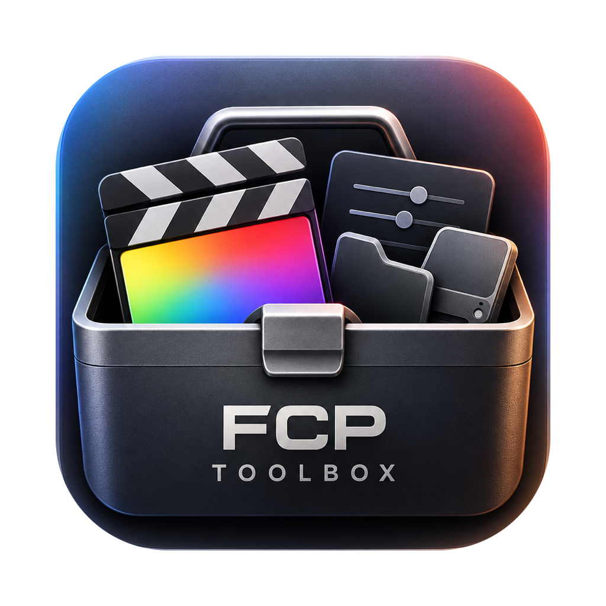
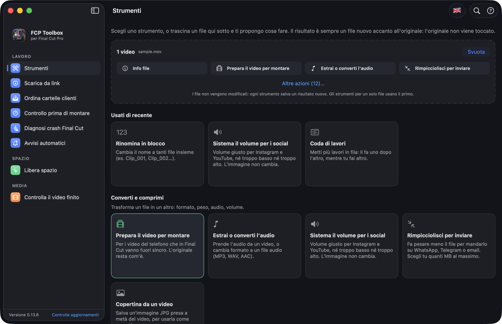
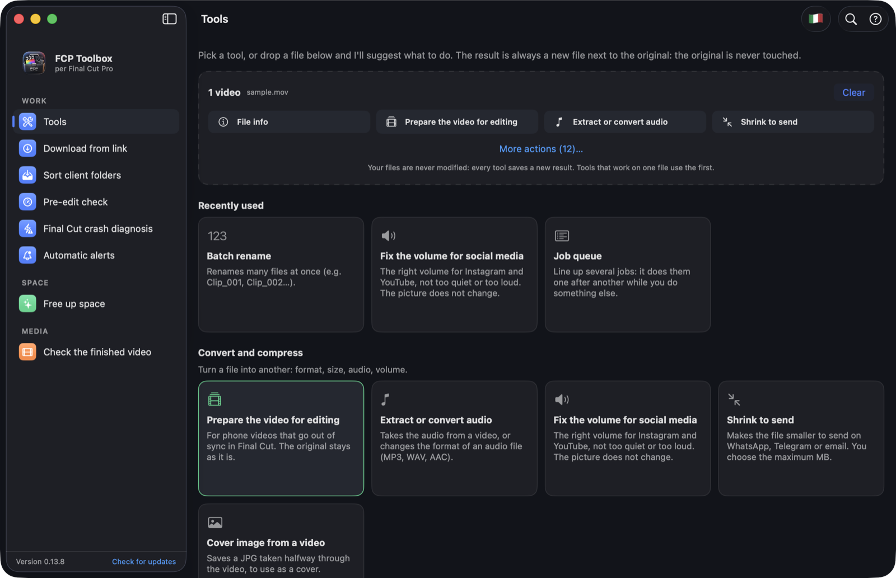
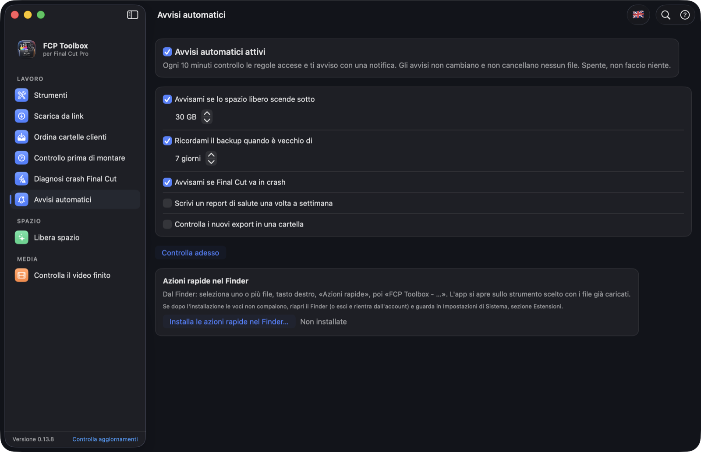

<p align="center"></p>

# FCP Toolbox

[🇬🇧 English](README.en.md) · 🇮🇹 Italiano

**La cassetta degli attrezzi gratuita per chi monta con Final Cut Pro su Mac.** Libera spazio sui dischi senza toccare gli originali, trova i media orfani e quelli mancanti, ordina le cartelle dei clienti, controlla il Mac prima di montare e spiega i crash di Final Cut. In più: backup verificato, salute delle librerie, strumenti video (convertire, comprimere, tagliare, sottotitoli, controllo di consegna per YouTube e Reels), ricerca nei filmati con AI locale e avvisi automatici.

Gira tutta in locale: nessun account, nessun dato inviato (internet si usa solo se lo chiedi tu: «Scarica da link» e «Controlla aggiornamenti»). Gratuita, open source (MIT), in italiano e in inglese.

*English: a free, open-source, fully offline macOS app that shows where your Final Cut Pro media space went: which imports are in use, which files no library uses (orphans), and which library links are broken. Universal binary, macOS 14+.*


<p align="center">
  
  
</p>
<p align="center">
  
</p>

## Perché esiste

Con i media su un disco esterno, Final Cut mette i file in `Final Cut Original Media/<giorno di importazione>/` e nelle librerie (`.fcpbundle`) lascia solo dei collegamenti. Il peso vero sta fuori dalla libreria, e Final Cut non ti dice quale parte è ancora usata.

## Strumenti

- **Pool clienti**: trascina la cartella scaricata (Drive, Download…). La sposta o copia in `Cliente / Video`, ordina le clip per nome, le controlla (VFR, HEVC, 4K, duplicati: le note dicono cosa può rallentare Final Cut) e crea un file `.fcpxml` che Final Cut apre come evento già pronto. Il cliente è un'ipotesi dal nome della cartella: puoi correggerlo.
- **Preflight**: prima di una sessione lunga controlla spazio, memoria occupata da altre app, risparmio energia e temperatura, e ti lascia chiudere (chiusura normale, con richiesta di salvare) le app pesanti come il browser. Non tocca mai app di sistema né Final Cut.
- **Crash di Final Cut**: legge i report in `~/Library/Logs/DiagnosticReports`, raggruppa i crash con la stessa causa, la spiega e copia un testo pronto per l'assistenza Apple.
- **Dischi**: spazio libero, stato SMART, avviso sotto una soglia, i file più grandi, e **Formatta un nuovo disco…** (APFS o Mac OS Esteso, GPT) con doppia conferma; solo dischi esterni fisici.
- **Backup verificato**: copia una libreria con controllo SHA-256, senza mai cancellare nulla; storico dei backup.
- **Cesto nella barra dei menu** (icona a destra, in alto): tieni file a portata di mano, trascinali sull'icona o nel popover e fuori di nuovo. Salva solo i percorsi, non copia niente. Chiusa la finestra l'app va in background, senza timer né polling.
- **Librerie e progetti**: l'albero librerie → eventi → progetti e clip, con il peso vero (anche dei media collegati fuori dalla libreria), ricerca, ordinamento ed esportazione CSV. Seleziona una clip e premi la **barra spaziatrice** per l'anteprima Quick Look, come nel Finder. Tasto destro per spostare nel Cestino una libreria, un evento, un progetto, una clip o il suo file video originale.
- **Mappa spazio**: una riga per ogni giorno di importazione, con peso, quanto è usato da una libreria e quanto no. Colonne ordinabili, “Mostra nel Finder”.
- **Media mancanti**: i collegamenti rotti delle librerie (le clip rosse), con l'indicazione di dove esiste ancora un file con lo stesso nome.
- **Media orfani**: file che nessuna libreria trovata usa. Li sposti nel **Cestino**, mai cancellati, e li puoi recuperare.
- **Cache e render**: svuota solo i render e i media ottimizzati dentro le librerie, mai gli originali.

- **Salute libreria**: punteggio 0–100 con i motivi (media collegati, backup, spazio, accesso, file rigenerabili), crescita nel tempo con previsione dello spazio e storico delle prestazioni del Mac mentre Final Cut è aperto.
- **Automazioni**: avvisi su spazio basso, backup vecchio, nuovi crash, report settimanale e controllo dei nuovi export. Tutto spento finché non lo accendi.
- **Ispettore media**: dettagli veri di ogni file, controllo di consegna (YouTube, Reels…), sottotitoli (controlli e correzioni SRT/VTT) e proxy.
- **Gestione media**: duplicati (solo Cestino), rinomina e organizzazione con annulla, confronto cartelle, impronta SHA-256 per verificare una copia.

## Come decide cosa è “orfano”

Legge i collegamenti simbolici nella cartella `Original Media` di ogni evento di ogni libreria trovata, e li confronta con i file in `Final Cut Original Media`. Quello che nessun collegamento raggiunge è un candidato orfano.

**Importante:** se usi una libreria che l'app non ha visto (per esempio su un altro disco), i suoi file sembreranno orfani. Aggiungi tutti i dischi prima di spostare qualcosa. Per questo l'app usa il Cestino.

## Sicurezza

Decidi tu cosa fare di dischi, cartelle, librerie, eventi e progetti. L'app ti avvisa, non ti blocca. Le regole fisse sono poche:

- Tutto ciò che elimini va nel **Cestino**, quindi si recupera finché non lo svuoti. Prima chiede conferma e dice cosa perdi.
- Agisce solo dentro i dischi e le cartelle che hai aggiunto, mai sulla cartella aggiunta stessa.
- Prima di toccare qualcosa ricontrolla il percorso sul disco, non si fida della lista mostrata.
- Rifiuta di agire se Final Cut Pro è aperto.
- “Cache e render” non segue i collegamenti simbolici e non svuota gli originali; per quelli usa “Librerie e progetti”.
- I “Media orfani” si spostano solo se almeno una libreria è stata analizzata.

## Specifiche

| | |
|---|---|
| Versione | 0.13.9 |
| App installata | 19 MB |
| DMG da scaricare | circa 7 MB |
| Mac supportati | Intel e Apple Silicon, macOS 14 Sonoma o più nuovo |
| Librerie esterne | nessuna (solo Swift e SwiftUI) |
| Programmi opzionali | `ffmpeg` per gli strumenti video, `yt-dlp` per «Scarica da link» (gratuiti, l'app spiega come installarli) |
| Componente aggiuntivo | «Cerca nei filmati» e «Descrivi clip» scaricano circa 800 MB, solo se li attivi |
| Lingue | italiano e inglese (cambio con la bandierina in alto) |
| Codice | circa 12.400 righe in 75 file Swift, 173 test automatici |
| Firma | semplice, senza notarizzazione Apple |
| Licenza | MIT |

## Installazione

**Da Terminale (Homebrew):**

```bash
brew install --cask julesna888/tap/fcp-toolbox
```

**Oppure con il DMG:**

1. Scarica l'ultimo `FCP-Toolbox-x.y.z.dmg` dalla pagina [Releases](../../releases).
2. Aprilo e trascina **FCP Toolbox** in **Applicazioni**.
3. Al primo avvio macOS lo blocca, perché l'app non è notarizzata (serve un account Apple Developer a pagamento). Per aprirla:
   - Prova ad aprirla, poi **Impostazioni di Sistema → Privacy e sicurezza**, in fondo premi **Apri comunque**.
   - Oppure da Terminale:

```bash
xattr -dr com.apple.quarantine "/Applications/FCP Toolbox.app"
```

(Con Homebrew questo passaggio lo fa già l'installazione.)

## Aggiornamento

- **Homebrew:** `brew upgrade --cask fcp-toolbox`
- **DMG:** nell'app, in fondo alla barra laterale a sinistra, premi **Controlla aggiornamenti** (accanto al numero di versione). Se c'è una versione nuova si apre la pagina di download: scarichi il DMG e trascini l'app in Applicazioni al posto della vecchia. Non si aggiorna da sola e il controllo parte solo quando lo chiedi. (Disponibile dalla versione 0.13.7; chi ha una versione più vecchia scarica il DMG nuovo dalla pagina Releases.)

## Uso

Trascina sulla finestra il disco dove tieni i media di Final Cut (⌘O per sceglierlo). L'analisi parte da sola.

## Compilare da sorgente

Serve Xcode (o Swift 5.9+).

```bash
git clone https://github.com/TUO-USERNAME/fcp-toolbox.git
cd fcp-toolbox
swift test
scripts/build_app.sh
```

## Limiti onesti

- L'`.fcpxml` del Pool non è stato provato in un Final Cut reale: l'apertura va verificata con una cartella piccola. Non prometto che importi più in fretta.
- I proxy sono controllati (apertura, durata, altezza, codec), ma che Final Cut li colleghi si vede solo in Final Cut. Il punteggio di salute usa pesi scelti da noi; le misure di prestazione sono del Mac in uso, non un benchmark di Final Cut; i profili di consegna sono indicativi.
- La spiegazione dei crash riconosce solo la causa “Invalid view geometry”; le altre le raggruppa senza spiegarle. Il formatter è provato solo su un disco immagine di prova.
- L'app è firmata ad-hoc, non notarizzata: al primo avvio tasto destro → Apri.

- Riconosce le cartelle per nome (`Final Cut Original Media`, `Original Media`, `Render Files`…), come le crea Final Cut in inglese. Una struttura diversa o localizzata non viene vista.
- Non sa quali clip sono dentro i progetti: “usato da una libreria” significa solo che esiste un collegamento, non che la clip sia montata.
- Il confronto per nome dei file mancanti è un indizio, non una garanzia che sia lo stesso file.
- Testato con test automatici su librerie finte e provato in sola lettura su librerie reali. Non con ogni versione di Final Cut Pro.
- Non rinomina né sposta eventi e progetti: eliminare un evento da fuori Final Cut può lasciare la libreria incoerente, fai prima un backup.
- Fai un backup prima di spostare media importanti. Software senza garanzie (licenza MIT).

## Licenza

MIT, vedi [LICENSE](LICENSE).

## Cosa vedi nella barra laterale
Strumenti, Scarica da link, Libera spazio, Ordina cartelle clienti, Controllo prima di montare, Diagnosi crash Final Cut, Avvisi automatici, Controlla video (con controllo di consegna, volume e silenzi misurati da ffmpeg).

Dentro «Strumenti» ci sono anche: Cerca nei filmati (AI locale gratuita, download una tantum ~800 MB), Info file, Rinomina in blocco, Calcolatore proporzioni, Cambi di inquadratura, Foglio provini, Taglia clip, Pulisci metadata, Colori e palette, Aree sicure social e Doppioni. Le aree sicure sono margini indicativi e modificabili: l'app non li aggiorna da sola.

Pool clienti: le clip importate vanno nel Cestino dopo 30 giorni (le cartelle restano); l'app lo scrive prima di ogni importazione. Funziona mentre l'app è aperta, anche nella barra dei menu.

Scarica da link (dentro Strumenti): serve yt-dlp: su Mac Intel recenti `brew install yt-dlp` compila cmake da zero e può durare ore, meglio `python3 -m venv ~/.local/share/yt-dlp && ~/.local/share/yt-dlp/bin/pip install yt-dlp && mkdir -p ~/.local/bin && ln -sf ~/.local/share/yt-dlp/bin/yt-dlp ~/.local/bin/yt-dlp`. Scarica solo contenuti tuoi o che hai il diritto di usare. Instagram e TikTok possono chiedere il login: in quel caso l'app lo dice, non usa i tuoi account.
